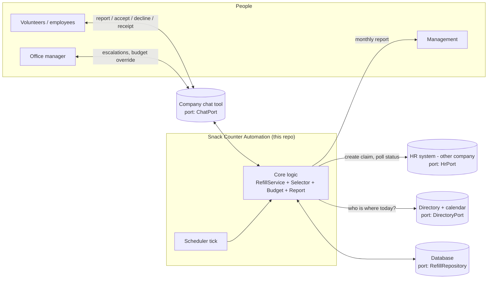
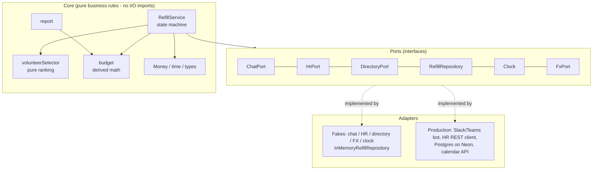
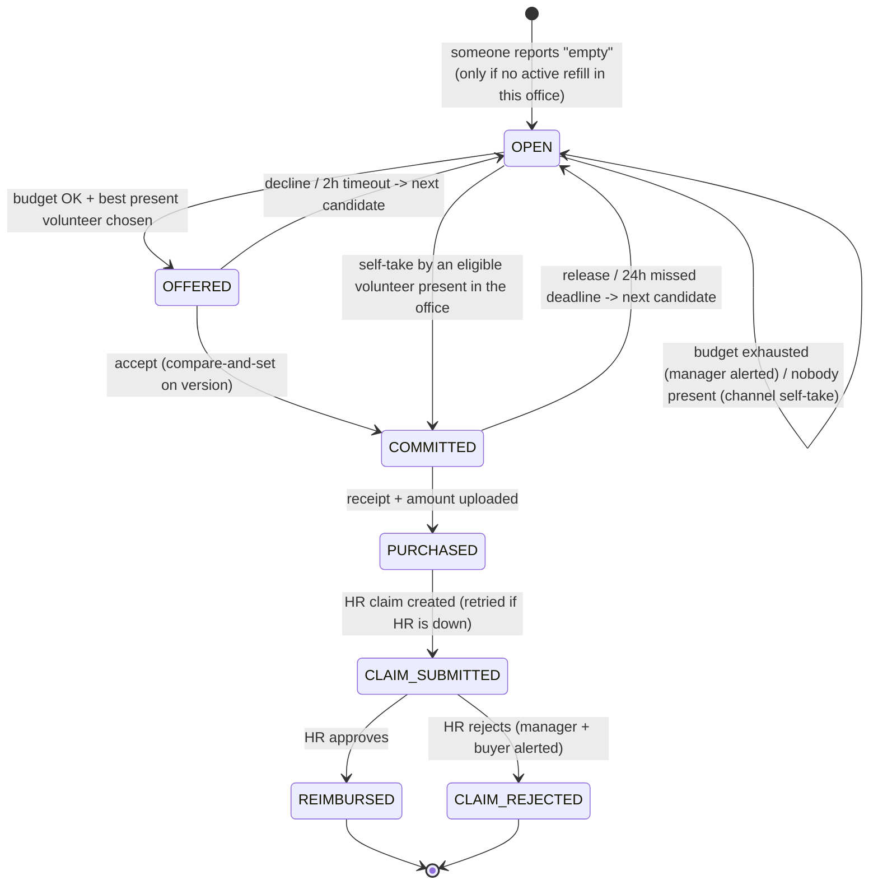
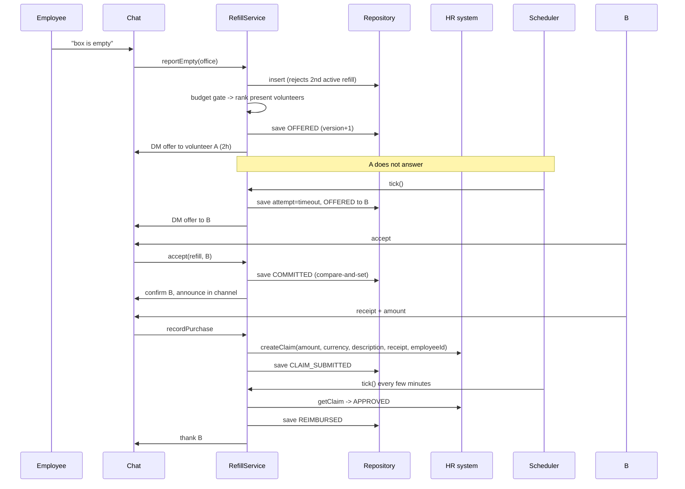
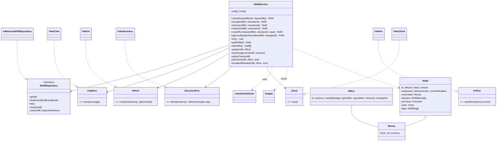
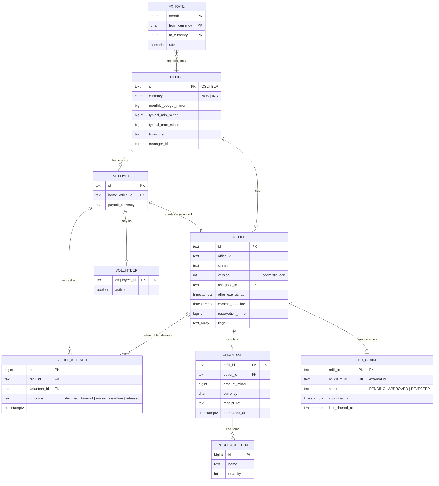

# Architecture – Snack Counter Automation

> Companion to [`readme.md`](readme.md) (how to run) and [`docs/DESIGN.md`](docs/DESIGN.md) (the 1–2 page design document the assessment asks for).
> This file explains **how it is built and why** – HLD, LLD, data model, tech-stack reasoning, and interview preparation.

---

## 1. The problem in one paragraph

Two offices (Oslo, NOK; Bengaluru, INR) keep a snack box stocked through unpaid volunteers who front their own money and claim it back from an **external HR system** (approval takes 1–10 days). It breaks because nobody *owns* the refill: boxes stay empty, two people buy on the same day, a few people carry the load and wait weeks for money, and nobody sees spend.
**"Automate" = give every refill exactly one owner with a deadline, rotate that ownership fairly, file the HR claim automatically, and track the money.** Buying snacks, approving claims and detecting an empty box stay human.

---

## 2. High-Level Design (HLD)

### 2.1 System context



### 2.2 Component view (hexagonal / ports-and-adapters)



**Why this shape:** the assessment explicitly says the chat tool and HR system are *simulated stand-ins*. Ports make the real systems swappable without touching a single business rule, and make every rule unit-testable with a fake clock.

### 2.3 Refill lifecycle (the heart of the system)



`OPEN / OFFERED / COMMITTED` are the **active** states: at most one per office.

### 2.4 Sequence – the main flow, including a hand-over



### 2.5 How each stated problem is prevented (one-line map)

| Problem from the brief | Mechanism | Where |
|---|---|---|
| Box empty for days | Named owner + 2 h offer / 24 h commit timers; auto hand-over; escalation to manager after 3 failures or 48 h | `RefillService.tick` |
| Two people buy the same day | One active refill per office + compare-and-set on `version` | `InMemoryRefillRepository.insert/save`, SQL partial unique index |
| A few people do all the work, wait weeks | Ranking by outstanding claims → recent refills → misses → longest idle; slow HR claims chased | `volunteerSelector.ts` |
| Nobody knows spend / what is eaten | Spend booked per purchase with line items; monthly report | `budget.ts`, `report.ts` |
| Budget overrun | `available = budget − spent − reserved`, checked at offer **and** at commit; reservation while committed | `budget.ts`, `RefillService.accept` |
| Hybrid / holiday / visitors | Eligibility = physically in *this* office today or tomorrow (directory/calendar) | `buildCandidates` |
| Two currencies | `Money` = integer minor units + currency; mixing throws; convert once per office total | `money.ts`, `report.ts` |

---

## 3. Low-Level Design (LLD)

### 3.1 Class / module diagram



### 3.2 Entity–Relationship diagram

The shipped demo runs on mock data (in-memory); [`docs/schema.sql`](docs/schema.sql) is the production PostgreSQL (Neon) schema for the same model.



**Two rules enforced by the database, not just by code** (see `schema.sql`):
1. `UNIQUE INDEX ... ON refills(office_id) WHERE status IN ('OPEN','OFFERED','COMMITTED')` → at most one active refill per office, even if two app instances race.
2. `UPDATE refills SET ..., version = version + 1 WHERE id = $1 AND version = $2` → compare-and-set. Zero rows updated = someone else won = `ConflictError`.

### 3.3 Algorithms

**Volunteer ranking** (`rankCandidates`, pure function – earlier rule dominates):
1. Physically in the office **today or tomorrow** (candidate filter, not a score).
2. Not at the **unreimbursed-claim cap** (2). Relaxed only if *everyone* is capped.
3. In the office **today** before "tomorrow".
4. Fewest **refills in the last 30 days**.
5. Fewest **missed commitments** (timeouts / missed deadlines; declines are free).
6. **Longest since last refill**.
7. Id – so the result is deterministic and testable.

**Budget** (`budget.ts`, all derived from history – nothing stored that can drift):
`available = monthlyBudget − Σ purchases in month (excl. rejected/cancelled) − Σ reservations of COMMITTED refills`
- A new refill needs `available ≥ typicalMin`.
- On commit, reserve `min(typicalMax, available)`.
- Month boundaries use the **office's timezone**.
- Over-budget purchases are **recorded and flagged**, never rejected – the money is already spent.

**`tick()`** – the single scheduler entry point. Idempotent sweep: offer timeouts, commit deadlines, 50 % reminders, escalation, HR claim retry, HR polling, slow-claim chasing. Safe to run twice, concurrently, or after downtime.

### 3.4 Concurrency model

`load → validate → mutate → save(expectedVersion) → only then send messages`.
Messages are sent **after** a successful save, so the loser of a race never tells anyone anything. Tests include a deliberate sabotage check: removing the version check makes the race tests fail.

### 3.5 Folder map

```
src/domain      money, types, errors, config (offices, budgets, timers), time helpers
src/ports       interfaces to chat / HR / directory / FX / repo / clock
src/adapters    simulated stand-ins + in-memory repository
src/services    refillService (lifecycle), volunteerSelector, budget, report
src/demo        deterministic end-to-end scenario
app/            Next.js demo page + /api/scenario (Vercel)
tests/          Vitest suites (74 tests)
docs/           DESIGN.md (1–2 page design), schema.sql (Neon/Postgres)
```

---

## 4. Tech stack – and *why*

| Choice | Why this | Alternatives considered |
|---|---|---|
| **TypeScript (strict)** | Discriminated unions and strict null checks make illegal states unrepresentable (`status` is a closed union). One language across core, tests and the Vercel demo. | Python (equally good for core; would need a second stack for the web demo), Java/Kotlin (heavier for a 2-hour exercise). |
| **Vitest** | Native TS/ESM, no config, fast (74 tests in < 1 s) – fast feedback matters when tests are the proof. | Jest (needs transform config for ESM/TS). |
| **Ports & adapters (hexagonal)** | The brief demands simulated chat/HR; ports make real ones a drop-in and keep rules testable. | Mocking libraries – more brittle than hand-written fakes. |
| **Injected `Clock`** | "Nobody completes it → hand over" is about *time*. A fake clock tests 24 h rules in microseconds, deterministically. | `jest.useFakeTimers` – patches globals, harder to reason about. |
| **Integer minor units + currency** | Floats drift; mixing NOK and INR must be a compile/run-time error, not a silent bug. | `decimal.js` (heavier; integers are enough because we only add and convert once). |
| **Optimistic locking (version)** | Contention is tiny (≈35 people) and conflicts rare; no long-held locks, works across serverless instances. | Pessimistic `SELECT … FOR UPDATE` (needs held connections, awkward on serverless). |
| **Polling scheduler (`tick`)** | HR gives no webhook guarantee; polling is simple, idempotent and recoverable after downtime. | Per-refill timers/queues – more moving parts, lose state on restart. |
| **Derived budget (no counters)** | Cannot drift or go out of sync; recomputation over ~tens of refills/month is trivial. | Stored running totals – fast but a consistency bug waiting to happen. |
| **Next.js on Vercel** | Zero-config deploy, static prerender of the deterministic demo, API route for JSON, and Vercel Cron can later call `tick()` in production (not wired in the demo, which has no persistent store). | Express + separate frontend (two deployables for no gain). |
| **Mock data now, Neon Postgres next** | The assessment values *reasoning and logic*, not infrastructure. The mock is behind `RefillRepository`; `schema.sql` is the Neon version. Neon is serverless Postgres with a generous free tier, HTTP/pooled driver for serverless, and branching. | SQLite (not usable on Vercel's read-only FS), DynamoDB (poor fit for relational reporting). |

---

## 5. Trade-offs and what we deliberately did **not** build

- **Sequential offers, not broadcast "first to click".** Slower best case, but removes the bystander effect and the race. Broadcast self-take exists only as the fallback when nobody is auto-selectable.
- **Presence before fairness.** An empty box today beats perfect rotation. Cost: office-goers do slightly more.
- **Wall-clock timers, no business-hours logic.** Simpler and predictable; an offer at 17:55 may expire overnight. Next step: quiet hours per office timezone.
- **Polling HR**, in-memory repo with real locking semantics; SQL provided but not wired.
- **Rejected claims are excluded from spend.** The manager resolves the money; the budget should not stay blocked.
- **Not built:** receipt OCR / amount verification, stock sensors, price benchmarking, multi-box offices, live FX feed, auth (company SSO sits in front of the bot), a full UI.

---

## 6. Assumptions (the questions I would have asked first)

1. HR has no reliable webhook → poll by claim id. 2. HR may not de-duplicate → we send an idempotency key **and** store `hrClaimId`. 3. Report currency NOK, rate per month from config, stored with the report. 4. One manager per office as escalation contact. 5. A calendar/directory API tells where someone is on a given day. 6. Visitors may volunteer – eligibility is *physical presence*, not home office. 7. Purchase is in the **office's** currency; HR converts to payroll currency.

---

## 7. Interview preparation

### 7.1 Likely questions and crisp answers

**Q: What does "automate" mean in your solution?**
Not "buy snacks automatically". The failure is diffusion of responsibility, so I automate *ownership*: one refill per office, one named owner with a deadline, automatic hand-over, automatic HR claim, tracked spend.

**Q: How do you stop two people committing to the same refill?**
Two layers. (1) At most one active refill per office – duplicate "empty" reports return the existing one (DB: partial unique index). (2) Every transition is compare-and-set on `version`; the loser gets `ConflictError` and no message is sent. Test: two concurrent `accept` calls → exactly one fulfils. I also verified the test fails if the check is removed.

**Q: What if the volunteer never answers / never buys?**
Offer expires after 2 h → next candidate. Commitment has 24 h with a reminder at 12 h; at the deadline it is handed over, the old owner is told not to buy, and a late purchase is rejected. After 3 failed attempts or 48 h the manager is paged. All driven by an idempotent `tick()`.

**Q: How is "who buys" decided?**
Present in the office → not already waiting for ≥ 2 reimbursements → in today → fewest refills in 30 days → fewest misses → longest idle → id. Pure function, deterministic, unit-tested.

**Q: How do you handle volunteers who work from home, holiday, or visit the other office?**
Eligibility comes from the directory/calendar: physically in *this* office today (or tomorrow). A Bengaluru employee visiting Oslo is an Oslo candidate; someone working from home is not.

**Q: How do you handle two currencies?**
`Money` is integer minor units + currency; every operation throws on mixed currencies. Budgets are enforced in the office's native currency. Only the monthly report converts, once per office total (so no per-purchase rounding drift), and it returns the FX rate used.

**Q: What if HR is down or slow?**
Down: refill stays `PURCHASED`, `tick()` retries; an idempotency key plus stored `hrClaimId` guarantees one claim. Slow: after 10 days the manager is chased at most once a day. Rejected: manager and buyer alerted, amount removed from spend.

**Q: Why not just broadcast to the channel and let the first person take it?**
That is the status quo that fails (bystander effect, double purchases). Sequential, targeted offers are fair and race-free. Broadcast is only the fallback when nobody is auto-selectable.

**Q: Why derive the budget instead of storing a counter?**
A stored counter can drift from reality (a missed update, a rejected claim). Deriving from the refill history is always correct, and data volume is tiny.

**Q: What if the budget is exhausted but the box is empty?**
No offer is made; the manager is told once and can approve an override (`approveBudgetOverride`). Purchases that exceed the budget are never blocked after the fact – they are recorded and flagged.

**Q: Why optimistic over pessimistic locking?**
Low contention, serverless-friendly (no connection held across requests), and the failure mode (retry/err) is fine for a chat interaction.

**Q: Is `tick()` safe to run concurrently or twice?**
Yes. It re-reads fresh state per refill; a `ConflictError` just means a user action won and the next run re-evaluates. A test proves a second run changes nothing.

**Q: How would you deploy this for real?**
Slack/Teams bot adapter → `ChatPort`; HR REST client → `HrPort`; Neon Postgres via `schema.sql` → `RefillRepository`; calendar API → `DirectoryPort`; Vercel Cron (or any scheduler) calling `tick()` every ~5 minutes; secrets in environment variables.

**Q: What would you build next?**
Quiet hours / weekends in `tick`, receipt amount validation (OCR), shopping-list suggestions from consumption data, snooze/vacation for volunteers, a manager dashboard, retries with backoff for HR.

**Q: What are the weaknesses of your design?**
Timers ignore business hours; presence data quality depends on people keeping calendars current; the claim cap can overload the few present volunteers in a small office; fairness counters use a fixed 30-day window; no receipt verification, so an inflated amount relies on HR approval.

### 7.2 Numbers worth remembering

Oslo 6 000 NOK (typical 300–1 200) · Bengaluru 15 000 INR (typical 500–3 000) · offer 2 h · commit 24 h · reminder at 50 % · escalate after 3 attempts or 48 h · claim cap 2 · fairness window 30 days · HR slow after 10 days, chase daily · 74 tests.

### 7.3 Test ↔ requirement map

| Brief says | Test file → test |
|---|---|
| Two people cannot both commit | `refillService.test.ts` → "RULE: two people cannot both commit…" (concurrent accepts, duplicate reports, stale writer) |
| Uncompleted refill handed to someone else | "RULE: a refill nobody completes…" (offer timeout, decline, missed deadline, release, escalation, idempotent tick) |
| Budgets and totals correct across both currencies | `budget.test.ts` (per-office, timezone month boundary, reservations), `report.test.ts` (NOK+INR total, rounding once), `money.test.ts` (no mixing) |
| Choosing who buys | `volunteerSelector.test.ts` |
| HR realities | `hrIntegration.test.ts` |
| End to end | `scenario.test.ts` |
